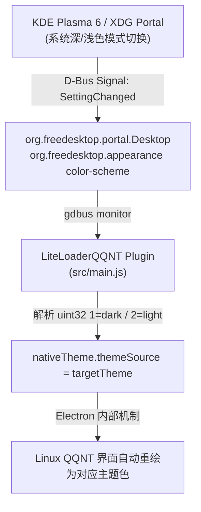

# LiteLoaderQQNT-KDE-Theme-Sync

[](https://github.com/LiteLoaderQQNT/LiteLoaderQQNT)
[](https://github.com/eacheat53/LiteLoaderQQNT-KDE-Theme-Sync)
[](https://opensource.org/licenses/MIT)

Linux 下自动监听并实时同步 KDE Plasma / XDG Desktop Portal 深浅色外观至 QQNT 的 LiteLoader 插件。

---

## 📖 背景与痛点 (Background)

在 Linux 环境（尤其是 **KDE Plasma 5 / 6**）下，QQNT 默认的 Chromium/Electron 运行环境无法自动跟踪桌面环境的全局深色/浅色模式切换：
- KDE Plasma 使用现代的 `org.freedesktop.portal.Desktop` (XDG Desktop Portal) 标准管理颜色偏好，而非传统的 GTK 配色配置。
- QQNT 主进程内建的 `nativeTheme.themeSource` 在启动后往往无法感知 KDE 外观的实时变动，导致系统切换深色模式后 QQ 依然保持浅色（或反之），必须重启 QQ 才能跟随。

**本插件通过监听 D-Bus 信号解决此问题**：毫秒级捕获 KDE Plasma / XDG 桌面外观变更事件，并即时同步到 Electron `nativeTheme.themeSource`，实现无缝平滑切换。

---

## ✨ 特性 (Features)

- ⚡ **实时响应（Zero Lag）**：通过 `gdbus monitor` 监听系统 D-Bus 事件，切换外观后毫秒级同步，无需手动刷新或重启 QQ。
- 🎯 **现代标准（XDG Portal Native）**：原生支持 `org.freedesktop.portal.Settings` 的 `org.freedesktop.appearance color-scheme` 标准（`1: dark`, `2: light`）。
- 🛡️ **优雅可靠（Auto-Reconnect & Safe Cleanup）**：
  - 启动时立即同步一次，确保初始状态与系统一致。
  - D-Bus 连接异常断开时具备自动指数退避重连机制。
  - 绑定 Electron 与 Node.js 退出钩子，退出时自动释放子进程资源，杜绝僵尸进程。
- 🐧 **多桌面兼容（Wide Linux Desktop Support）**：不仅完美适配 KDE Plasma 5/6，同时天然兼容 GNOME、Hyprland、Sway 等所有规范实现 XDG Desktop Portal 的 Linux 桌面。

---

## 🛠️ 工作原理 (Architecture)



---

## 📦 安装方法 (Installation)

### 方法一：Git Clone（推荐）

打开终端，直接克隆到 LiteLoaderQQNT 的插件目录即可：

```bash
git clone https://github.com/eacheat53/LiteLoaderQQNT-KDE-Theme-Sync.git ~/.config/LiteLoaderQQNT/plugins/kde-theme-sync
```

### 方法二：手动安装

1. 从 [Releases 页面](https://github.com/eacheat53/LiteLoaderQQNT-KDE-Theme-Sync/releases) 下载最新的源码压缩包。
2. 解压到 `~/.config/LiteLoaderQQNT/plugins/kde-theme-sync/`（确保 `manifest.json` 在该目录下）。
3. 重启 QQNT 即可生效。

---

## 📋 提交至官方插件商店 (Plugin-List Submission)

如需向 [LiteLoaderQQNT/Plugin-List](https://github.com/LiteLoaderQQNT/Plugin-List) 提交收录申请，可在其 `plugins.json` 中添加如下配置：

```json
{
  "repo": "eacheat53/LiteLoaderQQNT-KDE-Theme-Sync",
  "branch": "main"
}
```

---

## 📄 许可证 (License)

本项目基于 [MIT 许可证](LICENSE) 开源。
